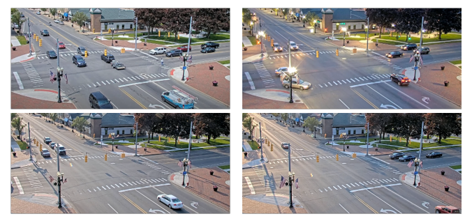
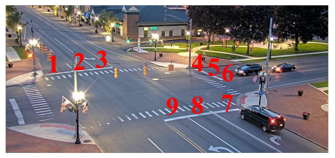
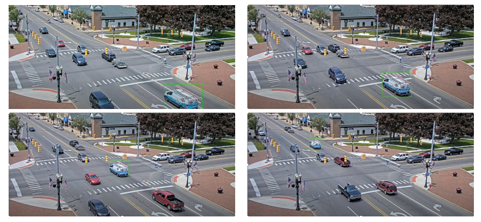

## Visual Traffic Monitoring at a Road Intersection

This project processes video from a static camera to:
- classify whether each road lane is occupied in a given frame (Task 1), and
- track a specific vehicle across frames in a video (Task 2).

In plain language, it finds vehicles in intersection images, checks which marked
lanes contain them, and follows one selected vehicle through a video. The
notebooks also include code to compare tracking predictions with ground truth.

Videos are taken at different times during the day/week, so illumination changes are visible in the scene:



### Repository structure
- `Task_1.ipynb`: Lane occupancy with YOLOv8 detections + polygon intersection.
- `Task_2.ipynb`: Vehicle tracking with OpenCV CSRT.
- `images/`: Figures used in this README.
- `requirements.txt`: Python dependencies for reproducibility.

---

## Setup

1) Create and activate a virtual environment (recommended):
```bash
python3 -m venv .venv
source .venv/bin/activate  # Linux/macOS
```

On Windows PowerShell, activate it with `.venv\Scripts\Activate.ps1` instead.

2) Install dependencies:
```bash
pip install -r requirements.txt
```

Notes:
- The notebooks expect input images, videos, and ground-truth files under
  `../test/`. Those files are not included here; update the notebook paths to
  point to your own data before running them.
- The YOLOv8 package (`ultralytics`) will pull a compatible PyTorch. For GPU acceleration, install a CUDA-enabled PyTorch build from the official selector if needed.
- OpenCV is provided via `opencv-python`.
- Geometry operations rely on `shapely`.

---

## Task 1: Lane occupancy with YOLOv8

Road lanes are numbered 1–3 (upper-left), 4–6 (right), and 7–9 (bottom-right):



Implementation notes:
- YOLOv8 (object detection) is used to detect vehicles.
- Classes considered: {2: 'car', 3: 'motorcycle', 5: 'bus', 7: 'truck'}.
- Lane polygons were annotated manually (e.g., using `https://nutbread.github.io/icm/`) and stored as coordinates.
- For each detection, we compute the intersection-over-box-area between the detection box and the lane polygon using `shapely`. A threshold of 0.7 marks the lane as occupied.

How to run:
1) Open `Task_1.ipynb` in Jupyter.
2) Ensure the video/frame source paths are correct in the notebook.
3) Run all cells to produce lane-occupancy outputs.

Reference tutorial used: `https://github.com/autogyro/yolo-V8/blob/main/examples/tutorial.ipynb`.

---

## Task 2: Vehicle tracking with OpenCV CSRT

The initial bounding box for the vehicle is provided for the first frame as `[xmin ymin xmax ymax]`, where `(xmin, ymin)` is the top-left and `(xmax, ymax)` is the bottom-right:



Implementation notes:
- Uses OpenCV’s CSRT tracker (`cv.legacy.TrackerCSRT_create`).
- Tracker initializes on the first frame and outputs a new bounding box per subsequent frame.
- Predicted boxes are compared with ground truth using intersection over union.
  In the notebook, a frame counts as a match at 0.2 or higher overlap, and a
  video passes the evaluation when at least 80% of its frames are correct.

How to run:
1) Open `Task_2.ipynb` in Jupyter.
2) Set the input video path and initial bounding box.
3) Run all cells; the notebook will track and log boxes per frame and compute metrics.

---

## Design choices

- Lane occupancy uses the area of a detected vehicle's box inside a manually
  marked lane polygon. This uses more of the vehicle's position than assigning
  a lane from its center point alone. The polygons must be redrawn for a new
  camera view.
- The tracking notebook includes an overlap-based check against ground truth
  so results can be inspected across frames and videos, not only by looking at
  the drawn boxes.

---

## Troubleshooting
- If PyTorch installation fails or GPU is not detected, follow the official PyTorch install selector for your CUDA/CPU setup and then reinstall `ultralytics` if necessary.
- On Windows, if OpenCV GUI functions are not available, ensure you run Jupyter locally (not inside WSL without an X server) or disable display windows in the notebook.
- If `shapely` wheels fail to install on some platforms, upgrade `pip` and `setuptools`.

---

## Citation and acknowledgements
- Original project: [Visual Traffic Monitoring at a Road Intersection](https://github.com/StegarescuAnaMaria/Visual_Traffic_Monitoring_at_a_Road_Intersection_Computer_Vision).
- YOLOv8 by Ultralytics.
- CSRT tracker via OpenCV.
- Manual lane polygon tool: `https://nutbread.github.io/icm/`.

